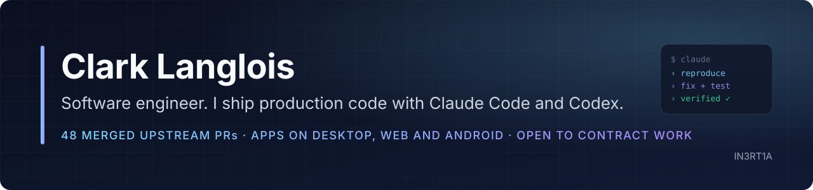

  

  
  
  

I build and ship software with **Claude Code** and **Codex** as my daily workflow. I set the direction, reproduce the problem, review every diff, and run the tests; the agents do the typing. Everything below is public and linked so you can check it.

**What I'm good at hiring-wise:** turning a vague bug report or feature ask into a reproduced, tested, merged change inside someone else's codebase; building small end-to-end products (desktop, web, Android); and making agent workflows cheap and reliable enough to run all day.

## At a glance

| | |
|---|---|
| **Merged upstream pull requests** | **48** across [HiveMind](https://github.com/xaviercallens/HiveMind/pulls?q=is%3Apr+author%3Aclark719664+is%3Amerged) (46), [Protocol-Canary #570](https://github.com/StellarCanary/Protocol-Canary/pull/570) and [Credence-Contracts #1636](https://github.com/CredenceOrg/Credence-Contracts/pull/1636) |
| **Under review right now** | 6 PRs in [excalidraw](https://github.com/excalidraw/excalidraw/pulls?q=is%3Apr+author%3Aclark719664), [highlight.js](https://github.com/highlightjs/highlight.js/pulls?q=is%3Apr+author%3Aclark719664) and [mermaid](https://github.com/mermaid-js/mermaid/pulls?q=is%3Apr+author%3Aclark719664) |
| **Shipped products** | PC Cast & TV apps (4 desktop editions), Hatchpile (web + Android), Lucent and Synapse (browser GPU demos) |
| **Languages in the work** | TypeScript, Python, Rust, Java, PowerShell, GDScript, Lean 4, WebGL2 |
| **Tooling I built for agent work** | [claude-code-toolkit](https://github.com/clark719664/claude-code-toolkit): hooks, local-model delegation, cost measurement |

## Shipped

<table>
  <tr>
    <td width="50%" valign="top">
      
      <h3><a href="https://github.com/clark719664/pc-tv-apps">PC Cast &amp; TV apps</a></h3>
      Casting, live-TV guides and remote control for PCs and TVs. Four Windows/Linux desktop editions, Android betas and a mobile Live web app. Python, packaged and sold as IN3RT1A.
       <a href="https://github.com/clark719664/pc-tv-apps/releases">Releases</a> · <a href="https://clark719664.github.io/pc-tv-apps/live/">Mobile Live</a>
    </td>
    <td width="50%" valign="top">
      
      <h3><a href="https://github.com/clark719664/hatchpile">Hatchpile</a></h3>
      A cozy physics merge puzzle with a shared daily puzzle. One codebase runs as an installable web app and as a signed Android APK via Capacitor.
       <a href="https://clark719664.github.io/hatchpile/">Play</a> · <a href="https://github.com/clark719664/hatchpile/releases/latest">Android</a>
    </td>
  </tr>
  <tr>
    <td width="50%" valign="top">
      
      <h3><a href="https://github.com/clark719664/lucent">Lucent</a></h3>
      A progressive GPU path tracer in TypeScript and WebGL2: glTF import, physically based materials, HDR lighting, and a render budget you pick for your GPU.
       <a href="https://clark719664.github.io/lucent/">Live demo</a> · <a href="https://github.com/clark719664/lucent">Engineering notes</a>
    </td>
    <td width="50%" valign="top">
      
      <h3><a href="https://github.com/clark719664/synapse">Synapse</a></h3>
      A browser trace explorer: service map, waterfalls and a live globe of Wikimedia edits. Imports OTLP/JSON, Jaeger and Zipkin traces.
       <a href="https://clark719664.github.io/synapse/">Live demo</a> · <a href="https://github.com/clark719664/synapse">Architecture</a>
    </td>
  </tr>
</table>

## Open-source work, with receipts

| Project | What I did | Status |
|---|---|---|
| [HiveMind](https://github.com/xaviercallens/HiveMind) | QUIC 0-RTT and STUN/TURN networking with loopback tests ([#40](https://github.com/xaviercallens/HiveMind/pull/40), [#73](https://github.com/xaviercallens/HiveMind/pull/73)), INT4/FP8 fused router and CUDA-stream prefetch kernels ([#23](https://github.com/xaviercallens/HiveMind/pull/23), [#7](https://github.com/xaviercallens/HiveMind/pull/7)), error-feedback compression ([#63](https://github.com/xaviercallens/HiveMind/pull/63), [#69](https://github.com/xaviercallens/HiveMind/pull/69)), Lean 4 conservation proofs ([#68](https://github.com/xaviercallens/HiveMind/pull/68)), CI and benchmark repairs ([#67](https://github.com/xaviercallens/HiveMind/pull/67), [#77](https://github.com/xaviercallens/HiveMind/pull/77)) | **46 merged** |
| [Credence-Contracts](https://github.com/CredenceOrg/Credence-Contracts) | Soroban bounty-escrow entry points and paginated views in Rust | [#1636](https://github.com/CredenceOrg/Credence-Contracts/pull/1636) **merged** |
| [Protocol-Canary](https://github.com/StellarCanary/Protocol-Canary) | `getHealth` RPC compatibility | [#570](https://github.com/StellarCanary/Protocol-Canary/pull/570) **merged** |
| [excalidraw](https://github.com/excalidraw/excalidraw) | Arrow-type switching for bound and labeled arrows, stable canvas search results while editing, searchable shortcuts in the help dialog | [#12503](https://github.com/excalidraw/excalidraw/pull/12503) · [#12504](https://github.com/excalidraw/excalidraw/pull/12504) · [#12505](https://github.com/excalidraw/excalidraw/pull/12505) open |
| [highlight.js](https://github.com/highlightjs/highlight.js) | PHP one-line comments now end at the closing `?>`; Ruby `Name::method` no longer read as a symbol | [#4572](https://github.com/highlightjs/highlight.js/pull/4572) · [#4573](https://github.com/highlightjs/highlight.js/pull/4573) open |
| [mermaid](https://github.com/mermaid-js/mermaid) | Build plugin that strips chevrotain's unreachable `eval` from the minified bundles (fixes a Firefox console warning) | [#8649](https://github.com/mermaid-js/mermaid/pull/8649) open |

Every one of these started the same way: reproduce the report against the current source, write the test that fails, make it pass, run the project's own lint and suite, then open one focused PR.

## How I work with coding agents

- **Reproduce first.** No fix goes out for a bug I could not trigger locally. If a report does not reproduce, I say so instead of guessing.
- **Tests that fail before and pass after.** Both runs go in the PR description.
- **Cheap, long sessions.** I wrote [claude-code-toolkit](https://github.com/clark719664/claude-code-toolkit): hooks that block repeat file reads, retire long-running agents before context cost compounds, shrink screenshots before a model sees them, and a wrapper that sends mechanical work to a free local model, with a ledger of what that saved.
- **Bounded claims.** My research repos ([Godot rollback coherence](https://github.com/clark719664/godot-rollback-coherence), [Ruffle portable states](https://github.com/clark719664/ruffle-portable-states), [Adobe Tone Lab](https://github.com/clark719664/adobe-tone-lab)) state exactly what was tested and what was not, including the experiments that failed.

## Background

Completed the requirements for an Associate of Applied Science in Networking &amp; IT Security at Muskegon Community College. Self-taught in everything above since, mostly by shipping.

**Stack I reach for:** TypeScript · Python · Rust · WebGL2 · Lean 4 · Linux · Godot · QUIC/STUN/TURN · Claude Code · Codex

## Work with me

Open to contract and freelance work: shipping features in your codebase with agent-assisted workflows, integrations, debugging, build and release tooling, and setting up Claude Code or Codex so your team gets the same results.

[Open an issue to start a conversation](https://github.com/clark719664/clark719664/issues/new) · [Full project catalog](https://github.com/clark719664/clark719664/blob/main/PROJECTS.md) · [Apps](https://payhip.com/IN3RT1A)
