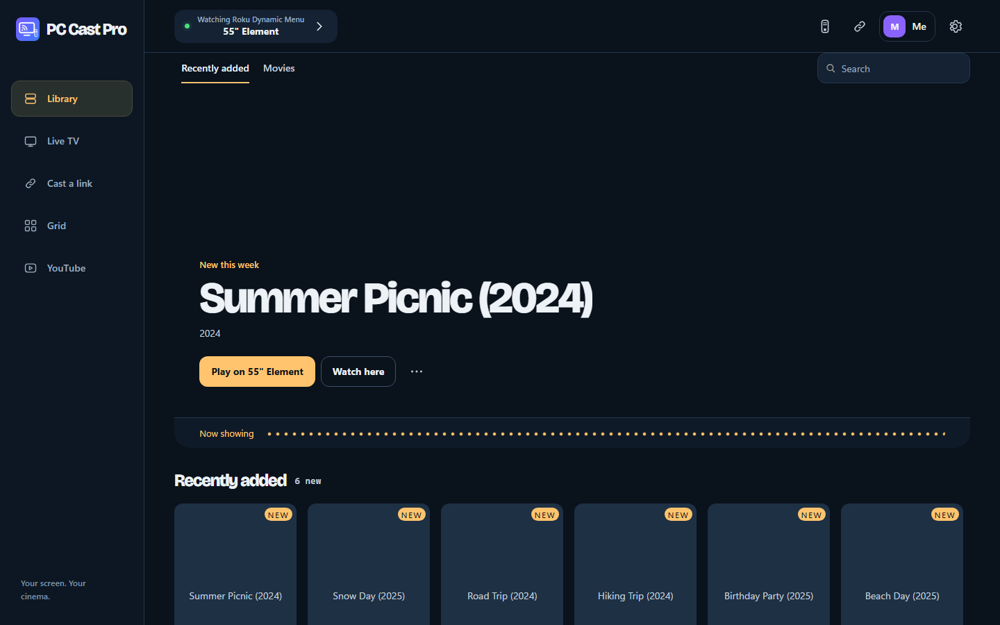
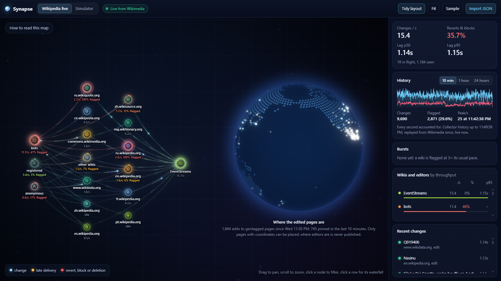

# Clark Langlois

**Developer building networked apps, browser graphics, and systems tools.**  
I publish as **IN3RT1A**. My work spans desktop and mobile software, open-source infrastructure, and reproducible engineering experiments.

**Open to paid development and automation work**, including app features, integrations, debugging, and workflow tools. Start a conversation through a [public project issue](https://github.com/clark719664/clark719664/issues).

[Explore all public projects](https://github.com/clark719664/clark719664/blob/main/PROJECTS.md) · [Apps and downloads](https://clark719664.github.io/pc-tv-apps/) · [Upstream contributions](https://github.com/xaviercallens/HiveMind/pulls?q=is%3Apr+author%3Aclark719664+is%3Amerged)

## Selected apps

### PC Cast & TV apps

Casting, live-TV guides, and remote control for PCs and TVs. Four Windows/Linux desktop editions, plus smaller Android betas and a mobile Live web app. Compatibility varies by TV; mobile support remains beta.

[Project](https://github.com/clark719664/pc-tv-apps) · [Downloads and release notes](https://github.com/clark719664/pc-tv-apps/releases) · [Mobile Live](https://clark719664.github.io/pc-tv-apps/live/)

### Lucent

A progressive GPU path tracer built with TypeScript and WebGL2. Import glTF models, explore materials and HDR lighting, and choose a rendering budget for your GPU.

[Live demo](https://clark719664.github.io/lucent/) · [Source and engineering notes](https://github.com/clark719664/lucent)  
Car Concept model: Darmstadt Graphics Group, CC BY; [asset credits](https://github.com/clark719664/lucent#credits).

### Synapse

A browser trace explorer with a service map, waterfalls, and a globe of Wikimedia edits. Import OTLP/JSON, Jaeger, or Zipkin traces, or explore the built-in simulator.

[Live demo](https://clark719664.github.io/synapse/) · [Source and architecture](https://github.com/clark719664/synapse)

## Systems work with evidence

- **Open-source contributions:** networking, GPU kernels, Lean 4 models, and verification improvements in [HiveMind](https://github.com/clark719664/clark719664/blob/main/PROJECTS.md#hivemind), plus merged Stellar/Soroban contributions.
- **Game technology:** [Godot rollback regression work](https://github.com/clark719664/clark719664/blob/main/PROJECTS.md#godot-rollback-coherence) and [restart-safe Ruffle checkpoints](https://github.com/clark719664/clark719664/blob/main/PROJECTS.md#ruffle-portable-states), each with an explicitly bounded test scope.
- **Research:** [Adobe Tone Lab](https://github.com/clark719664/clark719664/blob/main/PROJECTS.md#adobe-tone-lab) preserves measurements and rejected experiments. Adobe-equivalent rendering remains unsolved.

## Background and approach

Completed requirements for an **Associate of Applied Science in Networking & IT Security at Muskegon Community College**.

I use AI-assisted coding, debugging, and research, and document checks and limitations alongside the work. My focus is practical software, reproducible fixes, and clear evidence about what has actually been tested.

**Tools represented in these projects:** TypeScript · Python · Rust · WebGL2 · Lean 4 · Linux · Godot · QUIC/STUN/TURN.

See the [complete public catalog](https://github.com/clark719664/clark719664/blob/main/PROJECTS.md) for project maturity, contribution status, and technical evidence.
